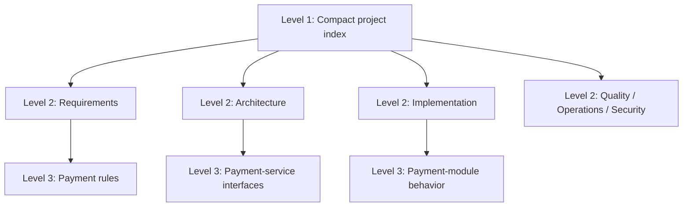
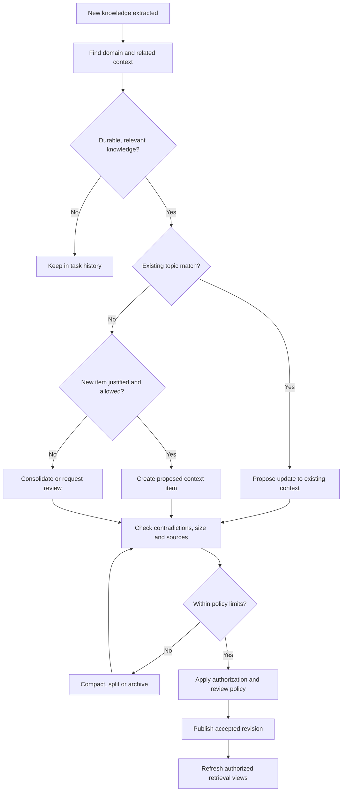
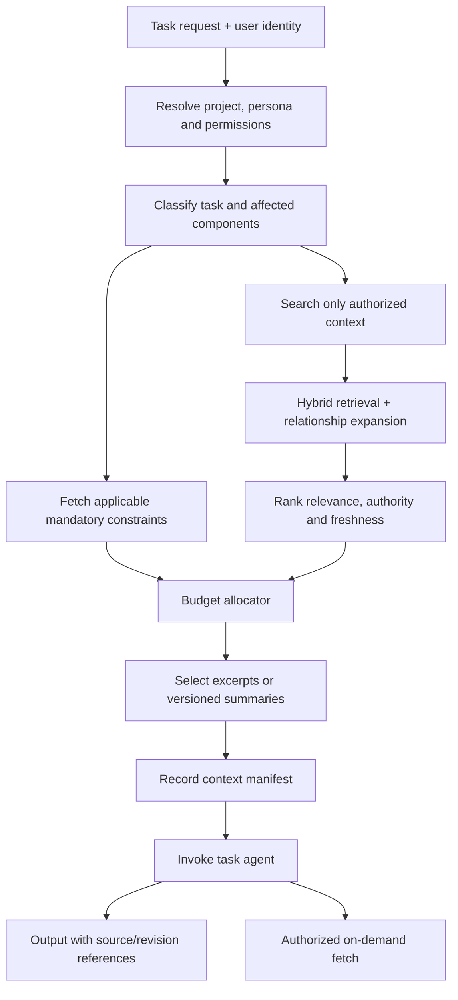
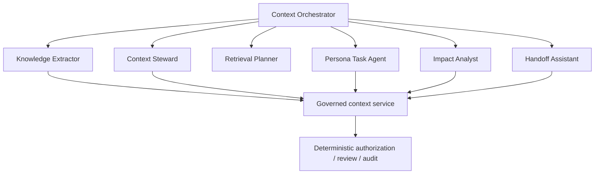
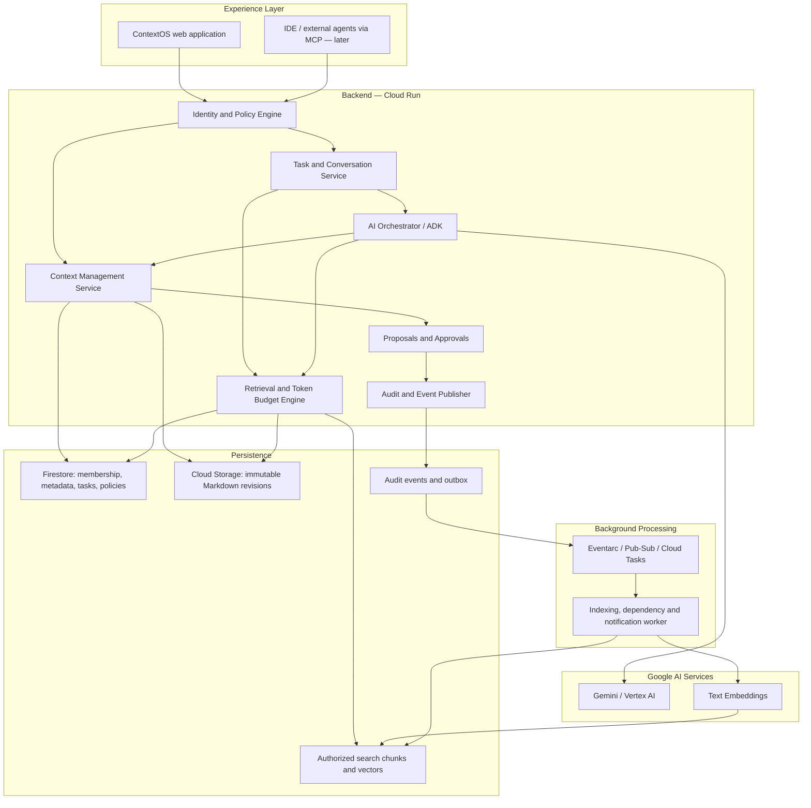
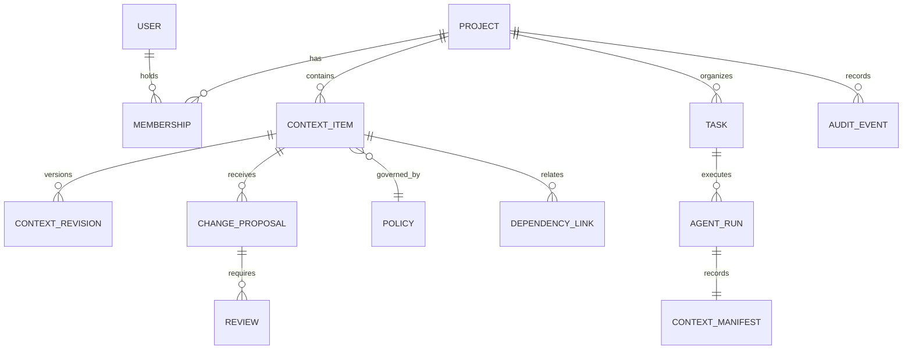
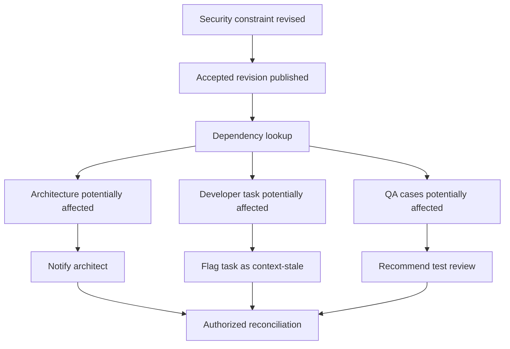

# ContextOS — Shared Intelligence for Agentic Software Teams

> **Complete project blueprint**  
> Product strategy · Feature specifications · System architecture · Knowledge lifecycle · Persona permissions · AI orchestration · Retrieval/token optimization · Implementation roadmap · Google Cloud AI Builder Cup 2026 alignment
>
> **Prepared:** 14 October 2026  
> **Status:** Proposed architecture and implementation plan; **not** a claim that the product has been implemented.

## Document purpose and source alignment

This document consolidates the complete ContextOS blueprint based on the project discussion and these user-provided source materials:

1. **`SHARED_AGENT_CONTEXT_PLATFORM.md`** (dated 13 October 2026): original concept, shared governed memory, task conversations, context revisions, permissions, audit history, bounded retrieval and MVP acceptance criteria.
2. **`ai_builder_cup_challenges_and_themes.txt`**: extracted Google Cloud AI Builder Cup 2026 themes, evaluation weights, timeline, technical eligibility and prototype-submission requirements.

**Interpretation:** Event rules and requirements cited below are from the supplied hackathon notes and should be reconfirmed in the active submission portal before submission. Design decisions, token sizes, numerical quotas, recommended technology and implementation timelines are **proposals**, not requirements contained in the sources. The long-term feature inventory is distinct from the minimum viable hackathon demonstration.

---

## 1. Executive overview

### 1.1 Vision

**ContextOS — A collaborative, permission-aware context orchestration platform that maintains a single, evolving understanding of a software project across stakeholders, AI agents, tools and development workflows.**

**Product promise:** **Define once. Share intelligently. Evolve together.**

Every stakeholder and AI agent receives the relevant, authorized and up-to-date understanding of the same project without repeatedly explaining requirements, copying conversations, or managing Markdown files manually.

ContextOS is **not** merely another AI coding assistant, chatbot, or document repository. It is the **coordination and intelligence layer** connecting a team, its accepted project knowledge, and its AI-powered work.

### 1.2 Primary product goals

- Preserve accepted business intent, decisions and constraints as work progresses from requirements to design, implementation, testing and operation.
- Make knowledge usable across people and agents with clear ownership and authorization.
- Keep Markdown as an internal, portable representation while showing users readable context pages and task interfaces.
- Enforce separation of concerns without preventing legitimate cross-role collaboration.
- Limit active knowledge fragmentation and the volume of context sent to models.
- Make changes, sources, revision histories and affected tasks traceable.
- Measure whether the system reduces repeated explanation, missed requirements, handoff delay and end-to-end token usage.

### 1.3 Five key capabilities extending the original concept

1. **Context intelligence:** Extract, classify, deduplicate, consolidate, retrieve and verify project knowledge.
2. **Cross-persona orchestration:** Coordinate Business, PM, Architect, Developer, QA, DevOps and Security workflows without transferring inappropriate authority.
3. **Knowledge lifecycle management:** Govern Markdown size, creation, splitting, merging, archival and revision history.
4. **Agent interoperability:** Serve authorized context to the platform's own agents and later to external coding assistants through well-defined tools.
5. **Measurable efficiency:** Benchmark retrieval relevance, constraint preservation, token expenditure and workflow overhead against a baseline.

### 1.4 Hackathon positioning

**Best-fit theme:** **Challenge 5 — Future of Work & Enterprise Productivity**. The supplied challenge statement emphasizes how individuals and organizations access knowledge, collaborate, make decisions and execute workflows.

**Published judging weights in the supplied notes:**

| Criterion | Weight |
|---|---:|
| Technical Merit & Gen AI Implementation | 40% |
| Problem Alignment & Impact | 25% |
| Innovation & Creativity | 25% |
| User Experience & Solution Design | 10% |

**Important deadline:** The supplied dashboard notes state **18 October 2026, 11:59 PM IST** as the prototype submission deadline. As of 14 October 2026, this is a compressed implementation window. The team should prioritize one convincing end-to-end workflow rather than implement every proposed feature.

---

## 2. Problem analysis: three distinct failures

### Problem A — Context degradation across stakeholders

A business requirement begins with a purpose, constraints and assumptions. Those details can be diluted or reinterpreted as knowledge passes through Business → PM/BA → Architect → Developer → QA → Operations.

**ContextOS response:** Maintain traceable relationships between business intent, accepted requirements, architectural decisions, code knowledge, operational constraints and test expectations.

### Problem B — Fragmented AI-agent knowledge

Stakeholders use separate assistants, chats and coding environments. An accepted decision made by one person is not automatically available to another person's agent. Temporary chat claims may be confused with official project decisions.

**ContextOS response:** Maintain shared, governed project knowledge outside individual conversations. Agents obtain task-appropriate context; task discoveries become shared knowledge only through publication and review.

### Problem C — Large, expensive and noisy context

Repeatedly supplying documentation, long histories and irrelevant instructions consumes tokens, increases costs and can make important details harder to locate.

**ContextOS response:** Assemble small, relevant, permission-filtered context packages with mandatory constraints, source references, on-demand expansion and explicit token budgets.

> **Core principle:** Shared persistent storage may be large; the context loaded into a single agent invocation must be bounded. Token savings are a measurable hypothesis, not an automatic benefit. Extraction, summarization, indexing and agent coordination may add overhead.

---

## 3. Complete feature inventory and priorities

Priority definitions:

- **P0:** Foundation or prototype-critical capability; the hackathon still needs a narrower selected subset.
- **P1:** Strong next iteration after the concept is demonstrated.
- **P2:** Advanced product/enterprise extension.

### 3.1 Project and team management

| Capability | Priority |
|---|---|
| Project creation, workspaces and membership | P0 |
| Multiple persona assignments per person | P0 |
| Project onboarding and compact overview generation | P0 |
| Organization administration, multi-project templates and SSO | P2 |

### 3.2 Shared context management

| Capability | Priority |
|---|---|
| Context pages backed by versioned Markdown | P0 |
| Requirements, architecture, decisions and QA context | P0 |
| AI-assisted classification and information extraction | P0 |
| Source references and explicit knowledge status | P0 |
| Document deduplication and consolidation | P1 |
| Dynamic splitting, merging and archival | P1 |
| Lifecycle policies, size thresholds and document quotas | P0 |

### 3.3 Persona permissions and governance

| Capability | Priority |
|---|---|
| Project-aware role-based access control | P0 |
| Separate View, Propose, Publish and Approve permissions | P0 |
| Open, Reviewed and Restricted context policies | P0 |
| Proposed revisions with reviewable diffs | P0 |
| Concurrent revision detection | P0 |
| Delegation, overrides and advanced policy administration | P2 |

### 3.4 AI intelligence and orchestration

| Capability | Priority |
|---|---|
| Task-aware retrieval | P0 |
| Persona-specific agent instructions and behavior | P0 |
| Requirement, decision and constraint extraction | P0 |
| Role-specific structured outputs | P0 |
| Contradiction and ambiguity detection | P1 |
| Suggested cross-role handoffs | P1 |
| Multi-agent delegation and execution | P1 |
| Human-in-the-loop approval gates | P0 |

### 3.5 Retrieval and token optimization

| Capability | Priority |
|---|---|
| Configurable context-token budget | P0 |
| Status-aware, permission-filtered retrieval | P0 |
| Keyword + semantic retrieval | P1 |
| Deterministic inclusion of applicable mandatory constraints | P0 |
| Source-and-revision context manifests | P0 |
| Caching and reusable derived summaries | P1 |
| Token/cost telemetry and baseline comparison | P0 |
| Adaptive conversation/context compaction | P1 |

### 3.6 Traceability and change propagation

| Capability | Priority |
|---|---|
| Requirement → decision → task/test dependency links | P0 |
| Auditable revision history and activity events | P0 |
| Warnings for dependent tasks when context changes | P0 |
| Stale-context alerts | P0 |
| AI-assisted propagation recommendations | P1 |
| Automated dependency discovery | P1 |
| Cross-project traceability graph | P1 |

### 3.7 Collaboration experience

| Capability | Priority |
|---|---|
| Persona-aware project workspace and task chat | P0 |
| Context inspector with citations and versions | P0 |
| Proposal review inbox | P0 |
| Filterable activity timeline | P0 |
| Context freshness and health indicators | P1 |
| Notifications and discussion threads | P1 |
| Cross-project knowledge reuse | P2 |

### 3.8 External integrations

| Capability | Priority |
|---|---|
| Import written requirements and meeting notes | P0 |
| GitHub code/repository references | P1 |
| MCP tools for coding agents | P1 |
| GitHub PR/commit change detection | P1 |
| Jira and Azure DevOps synchronization | P2 |
| Slack, Teams and meeting systems | P2 |
| IDE extensions and webhooks | P2 |

### 3.9 Security, quality and administration

| Capability | Priority |
|---|---|
| Server-side authorization and project isolation | P0 |
| Secure secret management and audit records | P0 |
| Retrieval, revision and permission tests | P0 |
| Prompt-injection safeguards | P0 |
| Operational tracing, analytics and logs | P1 |
| Configurable retention and compliance controls | P2 |
| Model/agent evaluation and comparisons | P1 |

**Scope guidance:** A successful P0 demonstration is not the sum of all P0 entries. It is one functioning cross-role workflow that proves shared context, access control, authorized change and updated retrieval.

---

## 4. Personas and separation of concerns

### 4.1 Responsibility is not authority

A **functional persona** describes which work an individual or agent performs; **authorization** determines what knowledge can be read, proposed, published or approved. A person may have multiple personas, and teams can define custom ones. A persona does not require its own database or dedicated LLM.

| Persona | Primary responsibility | Typical owned knowledge |
|---|---|---|
| Business stakeholder | Business goals and operational constraints | Objectives, business rules |
| End user/customer representative | User journeys and feedback | User stories, validated expectations |
| Product Manager / Business Analyst | Scope, priorities, acceptance criteria | Requirements and product decisions |
| System Designer / Architect | Interfaces, architecture and technology decisions | Architecture and ADRs |
| Developer | Implementation, technical discoveries | Code knowledge and module notes |
| QA Engineer | Quality criteria, scenarios, defects | Test strategy and expectations |
| DevOps / SRE | Deployment and production operations | Deployment and reliability context |
| Security Engineer | Security rules, risks and restricted findings | Security context |
| Project Manager | Coordination, milestones and dependency planning | Project status and milestones |

### 4.2 Permission types

- **View:** Read an authorized context item and permitted history.
- **Propose:** Suggest a change without changing accepted shared knowledge.
- **Publish:** Make an authorized revision the currently accepted version.
- **Approve:** Approve a specific proposed revision where policy demands review.
- **Manage Policy:** Change grants, owners and review requirements when authorized.

**Effective permission** depends on project membership, role grants, item policy, explicit restrictions and the requested action. Prompt instructions alone never grant rights.

### 4.3 Policy modes

| Mode | Reading | Changes | Example |
|---|---|---|---|
| **Open** | Authorized project members | Authorized contributors can publish routine changes; audit remains mandatory | Code notes |
| **Reviewed** | Authorized project members | Contributors propose; designated reviewers approve | Scope changes, architecture decisions |
| **Restricted** | Explicit grants | Explicit read/propose/publish/approve grants | Confidential vulnerabilities |

“Open” means open to authorized project contributors, **not** publicly accessible.

### 4.4 Illustrative persona/context matrix

**V = View; P = Propose; W = routine authorized Publish; A = Approve protected changes.** This matrix is a proposed default, not a fixed policy.

| Context domain | PM | Architect | Developer | QA | Security |
|---|---|---|---|---|---|
| Requirements | V/P/A | V/P | V/P | V/P | V/P |
| Architecture | V/P | V/P/A | V/P | V/P | V/P |
| Code knowledge | V/P | V/P | V/W | V/P | V/P |
| Test strategy | V/P | V/P | V/P | V/W | V/P |
| Security requirements | V/P | V/P | V/P | V/P | V/P/A |
| Restricted findings | Explicit grant | Explicit grant | Explicit grant | Explicit grant | Explicit grant |

### 4.5 Collaboration example

A developer discovers database contention in an accepted design. The developer's agent may inspect permitted architecture, explain the issue and create a proposed design change. The architect reviews the exact proposal. Until it is published, other agents should treat the existing accepted design as canonical while optionally surfacing an appropriate pending-change warning.

---

## 5. Markdown knowledge architecture

### 5.1 Three logical levels

1. **Project index:** Small overview, identifiers, owners, dependency pointers, mandatory constraints and navigation.
2. **Domain areas:** Requirements, Architecture, Implementation, Quality, Operations, Security, Meetings and Decisions.
3. **Topic-specific context:** Independently retrievable knowledge for services, rules, interfaces, tests and decisions.



This is a **logical** hierarchy: the system does not have to create an extra physical Markdown file for every hierarchy node.

### 5.2 Illustrative internal directory

```text
project-context/
├── PROJECT.md
├── requirements/
│   ├── checkout.md
│   └── payment-rules.md
├── architecture/
│   ├── system-overview.md
│   └── payment-service.md
├── decisions/
│   └── payment-retry-policy.md
├── implementation/
│   └── payment-module.md
├── quality/
│   └── checkout-tests.md
├── operations/
│   └── deployment.md
├── security/
│   └── payment-controls.md
└── meetings/
    └── planning-summary.md
```

**Users never need to navigate this directory.** They use context cards, task views and review pages. Filenames are implementation details; context IDs are stable across renames.

### 5.3 Canonical context item fields

| Field | Purpose |
|---|---|
| `context_id` | Stable identity independent of filename |
| `project_id` | Workspace boundary |
| `domain` | Requirements, architecture, quality, etc. |
| `title` | Readable name |
| `body` | Canonical Markdown content |
| `owner` | Responsible persona or group |
| `policy_id` | Effective access/review policy |
| `knowledge_status` | Discussed, accepted, implemented, superseded |
| `revision_id` | Immutable revision identity |
| `source_refs` | Originating meeting, requirement, task or commit |
| `dependency_ids` | Explicitly related context and tasks |
| `token_count` | Lifecycle and retrieval planning |
| `last_verified_at` | Freshness monitoring |

Keep **change workflow status** (proposed/reviewing/published/rejected), **knowledge status** (discussed/accepted/implemented/superseded), and **freshness** (current/stale/needs verification) separate.

A meeting summary can be published while reporting a proposal that remains merely discussed; it does not become an accepted project decision automatically.

### 5.4 Example topic document

```markdown
# Payment Retry Policy

Context ID: CTX-PAY-014
Domain: Architecture
Status: Accepted
Owner: System Designer

## Decision
Failed payment requests may be retried up to
three times for eligible transient failures.

## Rationale
Reduce temporary transaction failures without
creating duplicate charges.

## Constraints
- Use the existing idempotency key.
- Do not retry non-retryable errors.
- Apply the approved backoff strategy.

## Affected Components
- payment-service
- payment-api
- checkout-tests

## Source References
- REQ-PAY-007
- ADR-PAY-003
```

This Markdown content is illustrative. Production ownership, permissions, accepted revision and status should also be stored in authoritative metadata, not trusted solely from editable front matter.

---

## 6. Intelligent Markdown lifecycle management

A new message must **not** automatically produce a new permanent file. Otherwise the system recreates fragmentation inside its own knowledge store.

### 6.1 Proposed starting limits

| Control | Suggested prototype value | Purpose |
|---|---:|---|
| Ideal topic-document length | 600–1,200 tokens | Concise, focused context |
| Soft document limit | 1,800 tokens | Trigger compaction/splitting assessment |
| Hard document limit | 2,500 tokens | Stop uncontrolled growth |
| Retrieval passage | 150–350 tokens | Use small, targeted excerpts |
| Active documents per *demo* project | 30 | Discourage fragmentation |
| New-document creation | Governed by lifecycle checks | Prefer updating existing topics |
| Historical revisions | Store separately | Preserve audit and rollback |
| Archived/superseded documents | Exclude from default retrieval | Keep accessible under authorized history |

**Not enterprise hard ceilings.** A large project may need many more active context items; quotas should be configurable and based on size, complexity, ownership and retrieval performance. Active knowledge limits, archive retention and per-run retrieval budgets are different controls.

### 6.2 Lifecycle flow



### 6.3 New-document decision rules

Create a new item when it represents a meaningfully distinct topic, owner, access policy, lifecycle or component. Otherwise propose a change to an existing item.

Examples:

- New notes about the existing payment retry rule → propose updating that topic.
- Confidential vulnerability details → separate, restricted context item.
- Meeting transcript → extract candidate decisions and actions, then route them; do not create permanent files for every observation.
- Superseded policy → preserve history, remove from default active retrieval.

### 6.4 Compaction invariants

Any AI-generated compaction must preserve:

- Requirement and decision IDs.
- Normative constraints and acceptance criteria.
- Decision rationale and important rejected alternatives.
- Explicit exceptions and dependencies.
- Open questions, relevant risks and pending approvals.
- Originating source and revision references.

Compaction should create a **proposed revision** with a visible diff and checks against the original. For critical context, require owner review or validated source-coverage checks. If essential information cannot fit, split the context or adjust the policy; do not silently discard requirements.

---

## 7. Black-box Markdown user experience

End users interact with **knowledge and tasks**, not file paths. They can update context through a chat, form, document editor or imported source. Every entry point uses the same authorization and publication pipeline.

### Example natural-language update

**User:** “Customers must be able to retry a failed payment without being charged twice.”

**Internal processing:**

1. Interpret intent and extract a candidate requirement.
2. Find matching project, domain and existing topics.
3. Generate a structured proposed revision and source links.
4. Validate provenance, document limits, base revision and permissions.
5. Either publish directly under authorized policy or request approval.
6. On accepted publication, refresh the retrieval index and dependent-task state.

**User-facing result (only if publication succeeded):**

> Requirements updated: Payment retry safety. Context `CTX-REQ-007`, Revision 5. Two related tasks may require review.

If review remains pending, display **“Change proposed”**, not “Requirements updated.”

### Minimum context-card fields

- Title, domain, owner and status.
- Accepted revision and last update.
- Supporting source references and related tasks.
- Pending change proposals.
- Edit/propose controls allowed by effective policy.
- Permitted revision history and audit activity.
- Staleness, conflicts and superseded warnings.

---

## 8. Context retrieval and token optimization

### 8.1 Objective

Construct the **smallest sufficient, authorized and current context package** for each agent invocation. Avoid replaying the whole team's conversations or loading every `.md` file.

### 8.2 Retrieval flow



### 8.3 Retrieval algorithm

1. **Identify caller and task:** Establish user, project, effective roles, purpose and components.
2. **Enforce access:** Filter sources before any content reaches the model; recheck access on later fetches and shared results.
3. **Inject mandatory constraints:** Select applicable safety, compliance and required project rules deterministically.
4. **Retrieve candidates:** Use lexical matching, embeddings and explicit links among requirements, decisions, components and tests.
5. **Rank and deduplicate:** Favor relevant, accepted, current knowledge and avoid redundant revisions.
6. **Budget:** Reserve capacity for instructions, mandatory constraints, task state, selected knowledge, tool calls and final output.
7. **Record input provenance:** Save exact source IDs/revisions and which passages were actually loaded.
8. **Expand on demand:** Fetch further permitted context only when necessary.

**Role influences prioritization, not isolation.** Developers also need pertinent requirements, architecture and security constraints. Authorization is a hard prerequisite, not a numeric preference.

### 8.4 Optional scoring formulation

For authorized, non-mandatory context candidates:

\[
S = w_1 R + w_2 D + w_3 F + w_4 A + w_5 I
\]

Where:

- `R` = lexical and semantic relevance;
- `D` = relationship to task components, requirements and decisions;
- `F` = freshness;
- `A` = authority/acceptance state;
- `I` = importance to the task.

Weights must be calibrated against evaluation examples. Mandatory applicable constraints bypass optional ranking.

### 8.5 Illustrative 8,000-input-token allocation

| Category | Tokens |
|---|---:|
| System and agent instructions | 800 |
| Mandatory constraints | 1,000 |
| Selected project context | 3,000 |
| Task conversation and working state | 1,200 |
| Tool-result allowance | 2,000 |
| **Total input budget** | **8,000** |

This is an **illustration**, not a model-specific optimum. Reserve model output capacity separately, use the actual model tokenizer/context capacity and maintain headroom. If mandatory input exceeds the available budget, split the work or surface the limitation instead of dropping required constraints.

### 8.6 Efficiency techniques

| Technique | Benefit |
|---|---|
| Selective retrieval | Avoid irrelevant files |
| Chunked retrieval | Include sections, not whole documents |
| Hierarchical summaries | Compact overview before expansion |
| Deduplication | Avoid repeating decisions |
| Task-state compaction | Reduce conversation replay |
| Version-aware cache | Reuse valid context selections |
| Consistent snapshots | Avoid mixing incompatible versions |
| On-demand tools | Load details as needed |
| Source-linked summaries | Preserve traceability to authority |
| Explicit budgets | Prevent unbounded input growth |

Caches must include permission scope, policy identity and relevant source versions in their validity conditions. Restricted material and summaries derived from it must never be exposed to broader audiences.

### 8.7 Context manifests

For each agent run, record the exact source IDs and revisions actually delivered, including additional tool fetches during the run.

```json
{
  "run_id": "RUN-104",
  "task_id": "TASK-021",
  "actor_role": "developer",
  "context_snapshot": "SNAP-018",
  "sources": [
    {"id": "REQ-007", "revision": 5},
    {"id": "ARCH-012", "revision": 3},
    {"id": "SEC-003", "revision": 2}
  ],
  "project_context_tokens": 2130,
  "status": "completed"
}
```

**Inspector example:** “Used Checkout Requirements v5, Payment Architecture v3 and Security Constraints v2. One architecture proposal is pending review.”

An input manifest establishes what the agent had available; it does **not** prove the model followed all instructions or understood every source correctly.

### 8.8 Token-savings measurement

\[
\text{Token reduction (\%)} =
\frac{T_{\text{baseline}} - T_{\text{platform}}}
{T_{\text{baseline}}} \times 100
\]

Count **all model calls** attributable to the platform, not only the final task invocation: extraction, summarization, planning, compaction, the principal task agent and any related inference. Record embedding workload separately where appropriate. Compare equivalent tasks and outcomes.

A **30% reduction** could be an experiment target, **not** a product promise or measured result. First-run knowledge ingestion may cost more; repeated use across a team may amortize that cost.

---
## 9. AI agents and orchestration strategy

### 9.1 A central coordinator with specialized capabilities

Avoid launching a separate, always-running model agent for every role and every action. Begin with a central **Context Orchestrator** that invokes specialized capabilities only as needed. In the hackathon prototype, these can be different Gemini prompts and tool sets running in one application rather than independent deployed services.



| Capability | Input | Result |
|---|---|---|
| Knowledge Extractor | Stakeholder messages, meetings, tickets | Candidate requirements, decisions, constraints and actions |
| Context Steward | Candidate and existing context | Suggested update, merge, split, compact or create action |
| Retrieval Planner | Task goal and permitted index | Relevant ranked candidates and expansion needs |
| Persona Task Agent | Task + assembled context | Role-appropriate analysis, designs, test cases or implementation assistance |
| Impact Analyst | Accepted revision + dependency links | Potentially affected items and work |
| Handoff Assistant | Accepted outputs of originating role | Compact target-role handoff |

### 9.2 Agent control boundaries

The LLM may propose, classify, summarize and reason, but it must **not** be the final authority for:

- Authentication or privilege grants.
- Changing its own effective role or access policy.
- Approving a revision requiring independent review.
- Overwriting concurrent revisions.
- Silently omitting applicable mandatory constraints.
- Promoting unaccepted chat suggestions into accepted decisions.
- Revealing restricted data through responses, search results, summaries or caches.

Use **Google Agent Development Kit (ADK)** for tool-equipped Gemini workflows if it fits the prototype. Keep governance, persistence and policy checks in ordinary application services.

### 9.3 Agent interaction pattern

1. User initiates a task in their project and persona.
2. Application authenticates the user and resolves permissions.
3. Orchestrator requests an authorized context package.
4. Task agent answers or produces a proposed work artifact with source references.
5. If knowledge should change, agent calls **propose**, not unrestricted **write**.
6. Context service enforces the policy; a reviewer acts if required.
7. Publication generates revision and audit events; dependent work is checked.

---

## 10. End-to-end system architecture

### 10.1 Architecture recommendation

Use a **modular monolith deployed on Google Cloud Run** for the hackathon. Keep logical layers separate, but avoid unnecessary microservice deployment, networking and orchestration overhead.



**Important:** All client entry points, including MCP, pass through the same identity, authorization and policy boundary. Arrows are conceptual; an MVP need not deploy separate services for these components.

### 10.2 Suggested technology stack

| Layer | Recommended technology | Why |
|---|---|---|
| Web frontend | Next.js, TypeScript, Tailwind CSS | Fast dashboard/task UI development |
| Authentication | Firebase Authentication | Managed sign-in and identity |
| Backend APIs | Python + FastAPI | Good AI/Google Cloud SDK ecosystem |
| Agent workflows | Google ADK | Tool calling and agent orchestration |
| Generative model | Gemini on Vertex AI | Event alignment, extraction and reasoning |
| Operational data | Cloud Firestore | Project metadata, tasks, policies and audit pointers |
| Canonical Markdown revisions | Cloud Storage | Durable immutable revision objects |
| Retrieval index | Firestore vector search, plus keyword lookup | Avoid an extra vector database in the prototype |
| Embeddings | Vertex AI text embedding model | Semantic retrieval |
| Background tasks | Cloud Tasks, Pub/Sub or Eventarc, chosen as needed | Reindexing, dependency evaluation, alerts |
| Hosting | Cloud Run (optionally Firebase Hosting for frontend) | Meets stated Google Cloud deployment direction |
| Repository | Public GitHub repo with sanitized sample data | Hackathon deliverable |

**Technical caution:** Verify the current Firestore vector dimension limit and embedding model output dimensionality when implementing. If the embedding vector exceeds the index limit, request a supported reduced dimension (for example 768 or 1,536 where the model and index allow it).

### 10.3 Backend module organization

```text
backend/
├── api/
│   ├── projects/
│   ├── context/
│   ├── tasks/
│   ├── agents/
│   └── reviews/
├── core/
│   ├── authz/
│   ├── context_store/
│   ├── lifecycle/
│   ├── retrieval/
│   ├── token_budget/
│   ├── orchestration/
│   ├── impact_analysis/
│   ├── revisioning/
│   └── auditing/
├── agents/
│   ├── extraction/
│   ├── context_steward/
│   ├── persona_tasks/
│   └── impact_analysis/
├── integrations/
│   ├── vertex_ai/
│   ├── firestore/
│   ├── cloud_storage/
│   └── github/
└── workers/
    ├── index_worker/
    └── dependency_worker/
```

These are internal modules, not separately deployable services in the initial build.

### 10.4 Conceptual data model



Additional useful entities: `ContextChunk`, `RoleGrant`, `SourceReference`, `ContextSnapshot`, `Notification` and `IndexJob`.

### 10.5 Proposed API endpoints

| Endpoint | Responsibility |
|---|---|
| `POST /projects` | Create project |
| `POST /projects/{id}/members` | Add member/roles |
| `GET /projects/{id}/contexts` | List permitted context cards |
| `POST /projects/{id}/knowledge/ingest` | Extract candidate context |
| `POST /contexts/{id}/proposals` | Create proposed revision |
| `POST /proposals/{id}/approve` | Approve exact proposal |
| `GET /contexts/{id}/history` | Read permitted revision history |
| `POST /tasks/{id}/chat` | Execute role-aware task request |
| `POST /context/assemble` | Generate bounded authorized context package |
| `GET /runs/{id}/manifest` | Inspect sources provided to agent |
| `GET /projects/{id}/activity` | Permitted audit activity |
| `GET /projects/{id}/metrics` | Usage and retrieval metrics |

The frontend should not directly edit canonical Markdown objects or write authoritative review/audit records.

### 10.6 Atomic publication across Firestore and Cloud Storage

Firestore and Cloud Storage do **not** participate in a single shared transaction. A robust publication strategy:

1. Validate proposal structure, actor identity, policy, base revision and requested action.
2. Write the candidate Markdown body to an **immutable, unique Cloud Storage revision object**.
3. In a **Firestore transaction**, recheck current accepted revision/policy conditions and atomically update the accepted revision pointer plus audit/outbox record.
4. If the transaction fails, do **not** change accepted context. An unreferenced object can be cleaned up later.
5. A worker consumes the durable publication event and refreshes retrieval indexes, invalidates derived summaries and checks downstream tasks.
6. Use idempotency keys so retries do not double-publish.

Approval is bound to an exact proposal hash/revision. A proposal edited after approval requires fresh approval. Rollback is a **new revision**, never the destruction of previous history.

### 10.7 Audit record design

Record, as applicable:

- Event ID and timestamp.
- Project and context IDs.
- Human initiator, executing agent and agent run ID.
- Task/session ID.
- Before/after revision IDs and relevant diff.
- Reason and supporting sources.
- Review/approval identity and references.
- Applied policy version, authorization result and outcome.

Audits should be append-only to ordinary application actors. For strict compliance, protected retention or tamper-evident mechanisms require explicit implementation; an ordinary database or Git repository is not inherently tamper-proof.

Restricted document titles, diffs and activity metadata must not leak in broadly visible audit feeds.

---

## 11. External agent interoperability via MCP

### 11.1 Why interoperability matters

Developers may use different coding assistants and IDEs. ContextOS should not require all work to happen in its own chatbot. The long-term value is a **shared intelligence layer**, independent of agent client.

### 11.2 Proposed Model Context Protocol tools

```text
context.search
context.get
context.assemble
context.propose_change
context.get_dependencies
context.get_recent_changes
context.get_task_manifest
```

Each tool call must authenticate its caller, resolve effective permissions, and enforce the same governance logic as the web app.

**Example:** “Implement the payment retry endpoint using the current approved architecture.”

1. Coding agent obtains a scoped authorized context package.
2. Package contains only pertinent accepted requirements, interfaces and constraints.
3. Coding agent performs implementation work in its environment.
4. If it discovers a design inconsistency, it creates a **proposal** instead of editing accepted architecture directly.
5. Approved publication updates the shared knowledge for other stakeholders.

**Roadmap position:** Expose one or two read-only MCP tools after the native web workflow works. Full multi-client auth delegation, bidirectional IDE workflows and remote MCP compatibility belong to subsequent iterations.

---

## 12. Example complete cross-role product workflow

**Demo domain:** E-commerce payment retry and duplicate-charge prevention.

1. **Business:** “Customers must not be charged twice when retrying a failed payment.” ContextOS extracts the candidate business intent and preserves its source.
2. **PM/BA:** Defines accepted retry scope, failure categories and testable acceptance criteria. A versioned requirement is published.
3. **Architect:** Defines idempotency keys and the approved retry mechanism, linking it to the requirement.
4. **Developer:** Starts a task. The coding agent retrieves accepted requirements, architecture, interface contracts and security constraints—not the PM's entire conversation.
5. **QA:** Derives test scenarios for transient errors, duplicate submissions, invalid retries and exhaustion using the same accepted source references.
6. **Security:** Introduces an approved new constraint affecting retry behavior.
7. **Project lead:** Reviews which accepted contexts, implementation tasks and tests are potentially affected, and who must respond.

### 12.1 Change propagation



Begin with **explicit** links between requirements, decisions, components and tests. AI can recommend additional links, but should not claim complete impact coverage. The product should say “potentially affected” unless a stronger guarantee is established.

### 12.2 What makes the workflow valuable

A decision is not only remembered. It is **owned, accepted, referenced by agents, revised under policy and connected to affected work**. The problem is coordination and controlled change, not merely document search.

---

## 13. Step-by-step implementation roadmap

The recommended dependency order is:

**Persistence and access → Governed changes → Selective retrieval → Agent tasks → Change propagation → Cost and quality optimization → External integrations.**

### Phase 1 — Foundation

1. Define `Project`, `Membership`, `ContextItem`, `ContextRevision`, `Policy` and `Task` models.
2. Establish authentication, project memberships and persona assignments.
3. Implement versioned Markdown persistence with stable IDs.
4. Enforce View/Propose/Publish/Approve actions server-side.

**Done when:** Two team members can view authorized project knowledge, and restricted access is correctly denied.

### Phase 2 — Knowledge intelligence

1. Create ingestion endpoint for stakeholder notes and meeting content.
2. Use Gemini to extract candidate requirements, decisions, constraints and action items.
3. Identify topic matches against existing knowledge.
4. Add size/quantity limits and deduplication rules.
5. Generate proposed context revisions and diffs with source references.

**Done when:** Natural language can become a correctly categorized context proposal without manual Markdown editing.

### Phase 3 — Governance and collaboration

1. Create proposal workflow with target context, base revision and reason.
2. Implement authorizations and approval policy.
3. Reject stale-base proposals and invalidate approvals if a proposal changes.
4. Produce attributable audit events.
5. Display accepted context pages, review inbox and histories.

**Done when:** A developer can propose architecture changes and an architect can approve an exact, versioned revision.

### Phase 4 — Agent runtime and retrieval

1. Add independent task conversations and working state.
2. Implement permission-aware context retrieval.
3. Add mandatory constraints, relevance ranking and token-budget allocation.
4. Connect Gemini/ADK to role-specific task workflows.
5. Save context manifests showing all actually supplied source revisions.

**Done when:** Different users' agents share relevant approved knowledge without exceeding their own authorization boundaries.

### Phase 5 — Change intelligence

1. Link requirements, architecture, implementation tasks and tests.
2. Trigger dependency evaluation on new accepted revisions.
3. Mark dependent task context as stale or needing verification.
4. Notify appropriate owners and reviewers.
5. Allow tasks to explicitly adopt newer context and reevaluate outputs.

**Done when:** A changed requirement produces an appropriate warning for linked implementation and QA work.

### Phase 6 — Optimization and validation

1. Meter model calls and context sizes.
2. Evaluate retrieval relevance, omissions and permission correctness.
3. Add version-safe cache and compaction.
4. Benchmark against independent assistants with manually supplied context.
5. Run security, concurrency, stale-context and agent regression tests.

**Done when:** Correctness and measured usage improvements (or their tradeoffs) can be shown with repeatable test cases.

### Phase 7 — Enterprise integrations

1. Expose MCP-based read/propose tools.
2. Associate repository paths, commits and PRs with project context.
3. Add ticket/meeting integrations with provenance.
4. Support retention, quotas, policy delegation and observability.
5. Scale indexing and asynchronous processing when workloads justify it.

**Done when:** Authorized AI tools outside the web app can participate in the same governed project memory.

---

## 14. Hackathon MVP and execution plan

### 14.1 The one workflow to prove

**A PM, Architect, Developer and QA collaborate on one feature while the shared context layer tracks accepted decisions, enforces edit ownership and identifies affected work when knowledge changes.**

A Security persona can be added if core functionality is stable.

### 14.2 Five recommended prototype screens

1. **Project Overview:** Project details, personas, team members, contexts, active tasks, pending reviews and freshness status.
2. **Shared Knowledge:** Readable accepted requirements, architecture, versions, owners and sources—not raw file management.
3. **Persona Task Workspace:** Gemini chat/tasks, role-specific work, citations and a “Context used” inspector.
4. **Change Review:** Proposed revision, diff, source and reviewer controls.
5. **Context Insights:** Dependency links, potentially stale work, activity, retrieval usage and token baseline comparison.

**UX guidance:** Build five views in one application, not separate apps per stakeholder. Preserve consistent permissions and navigation throughout.

### 14.3 Compressed October 14–18 plan (IST)

| Date | Work focus | Desired deliverable |
|---|---|---|
| **14 Oct** | Foundation | Dashboard skeleton, seeded personas, Firebase Auth, Firestore schema, Markdown storage |
| **15 Oct** | AI knowledge engine | Gemini extraction, classification, matching, retrieval and basic token budget |
| **16 Oct** | Collaboration | Role-aware task interaction, proposals, approvals and authorization |
| **17 Oct** | Differentiation | Dependency warnings, context inspector, activity timeline, basic usage benchmark and tests |
| **18 Oct** | Submission | GCP deployment verification, demo recording, pitch PDF, README, public GitHub, final portal submission |

This is an aggressive schedule and should be treated as a prioritization plan, not a promise that every item will be completed in four days.

### 14.4 Defer until after the hackathon

- Full GitHub/Jira/Azure DevOps synchronization.
- Slack/Teams ingestion and rich meeting transcription.
- Enterprise SSO, policy delegation and arbitrary persona configuration UI.
- Fully automatic Markdown splitting/merging and broad knowledge-graph extraction.
- IDE extensions and multi-provider MCP compatibility.
- Automatic code refactoring and many-agent autonomous execution.
- Distributed microservices and broad-scale enterprise retention/compliance features.

### 14.5 Suggested 3–4 minute demo script

| Time | Segment | Demonstration |
|---|---|---|
| 0:00–0:25 | Problem | Show fragmented requirements and separate stakeholder agents |
| 0:25–1:00 | Shared context | PM defines payment requirement; Gemini organizes it without manual Markdown |
| 1:00–1:35 | Cross-persona context | Architect and Developer retrieve the same accepted requirement in distinct workflows |
| 1:35–2:10 | Governance | Developer proposes architecture change; Architect reviews/approves exact revision |
| 2:10–2:45 | Change awareness | QA sees updated context; changed constraint flags affected work |
| 2:45–3:20 | Inspectability | Show context manifests, audit versions, dependencies and real measurement |
| 3:20–3:40 | Impact | Explain reduction of repetitive context reconstruction and controlled change |

The supplied dashboard notes specify a **3–4 minute** demo, while the separate themes summary uses the wording **3 minutes**. Follow current portal instructions; targeting roughly 3 minutes 20 seconds to 3 minutes 40 seconds may satisfy the specific 3–4 minute window, subject to confirmation.

### 14.6 Submission requirements from supplied documentation

- Team size in notes: **2–4 participants**; stated team-formation deadline was **11 October 2026**.
- **Selected category:** Future of Work & Enterprise Productivity.
- **Working deployed prototype** on Google Cloud (Cloud Run/Firebase/GCP as specified).
- **Google AI/agentic technology**: e.g. Gemini/Gemma or applicable Google agentic platform, as described in provided theme notes.
- **Pitch deck PDF** following the prescribed template; dashboard notes state maximum **5 MB**.
- **Public demonstration link** (YouTube, Vimeo or public Google Drive), with prescribed duration.
- **Accessible public GitHub repository** with source and documentation for evaluation.
- **Brief description** within **1,024 characters**, explicitly describing Google Cloud/Firebase usage.
- **English-language** materials as indicated in theme notes.
- **Working deployment availability** throughout evaluation.
- Dashboard note's **prototype submission deadline: 18 October 2026 at 11:59 PM IST**.

**Prescribed deck template in the supplied notes:**  
https://docs.google.com/presentation/d/13rg7vW43mEH6DkpuusAE6fdoEylSFz8waNpE4RLzoUg/edit?slide=id.p#slide=id.p/export/pptx

### 14.7 Submission-readiness checklist

- [ ] Working prototype deployed to Cloud Run or Firebase
- [ ] Gemini-based extraction and role-specific task interaction
- [ ] Shared versioned Markdown hidden behind the interface
- [ ] Server-enforced permissions and review flow
- [ ] Short, public, working demonstration video
- [ ] Prescribed pitch deck converted to a compliant PDF
- [ ] Public GitHub repository with sanitized sample data
- [ ] Brief description within the specified length
- [ ] Correct challenge theme selected
- [ ] Deployed application confirmed accessible before submission

---

## 15. Security, correctness and failure handling

### 15.1 Risk-control matrix

| Risk | Required design control |
|---|---|
| Unauthorized context access | Server-side project, document and operation authorization |
| Privilege escalation by prompting | Enforce policy outside model messages |
| Leaks via derived summaries | Restrict summaries, snippets, caches and indices by originating access policy |
| Concurrent edits overwriting each other | Base-revision validation and compare-and-swap publication |
| Approval reused for changed proposal | Bind approval to exact proposal content/hash |
| Suggestions mistaken for policy | Distinct workflow, knowledge-status and freshness fields |
| Prompt injection from documents | Treat imported text as untrusted data; limit tool authority |
| Stale knowledge in long tasks | Snapshot manifests, freshness checks and explicit revision adoption |
| Cross-project search leakage | Tenant-scoped retrieval and negative access tests |
| Secrets in public repo | Synthetic demo data, secret scanning, secure runtime credentials |

### 15.2 Key design requirements

1. **Prefer document-level access boundaries initially.** Place differently sensitive information in separate items rather than relying on arbitrary section redaction.
2. **Keep revisions immutable.** Rollback creates a new revision referencing restored content.
3. **Restrict agent mutation tools.** Proposals are distinct from publication.
4. **Make freshness explicit.** A task operating against Architecture v4 must not silently combine it with incompatible current requirements.
5. **Retain humans as accountable decision owners.** Agent consensus is not equivalent to approval.
6. **Recheck authorization on reads and derived views.** Search snippets, audit feeds, summaries and caches can all leak context if treated differently from raw files.

### 15.3 Five non-negotiable prototype tests

1. A developer lacking explicit permission cannot retrieve a restricted security finding, including via semantic search or derived summary.
2. A developer's proposed architecture update cannot become accepted without the required reviewer.
3. Concurrent updates detect a stale base rather than silently overwrite prior publication.
4. The Context Inspector shows exactly which revisions were actually supplied to the agent.
5. An accepted change flags at least one known, explicitly linked downstream task.

Additional tests worth implementing: duplicate event retries, tampered approval payload, revoked access against cached results, mandatory context over-budget, stale summary invalidation and rollback history preservation.

---

## 16. Success metrics and evaluation plan

Create a synthetic test project with labeled requirements, decisions, architecture items, tasks, test cases and known dependencies. Compare ContextOS against a baseline where individuals manually transmit context between independent assistants.

| Metric | Evaluation method | Target direction |
|---|---|---|
| Retrieval relevance | Ground-truth labeled sources vs retrieved passages | Higher precision/recall |
| Requirement preservation | Count original constraints retained downstream | Higher |
| Cross-role consistency | Check use of same accepted decisions | Higher |
| Repeated explanations | Number of restatements of existing knowledge | Lower |
| Total token usage | Sum all attributable model tokens for comparable workflows | Lower |
| Handoff preparation time | Time until another role can begin productive work | Lower |
| Stale-context detection | Detect known affected tasks after a source revision | Higher recall |
| Unauthorized data exposure | Negative role and derived-view tests | Zero observed exposures |
| Governance overhead | Time/effort in review and publication | Controlled |

### Evaluation scenarios

**A. Repeated question:** Multiple stakeholders ask about the same accepted payment rule. Compare manual context explanation, retrieval relevance and aggregate usage.

**B. Cross-role handoff:** PM → Architect → Developer → QA. Check whether downstream work retains the original intent, constraints and accepted decisions.

**C. Changed decision:** Publish a revised accepted requirement. Verify dependency warnings, stale-task state and authorized reconciliation.

Report authentic measurements, including overhead. Do not claim guaranteed token reduction or fabricate benchmark percentages. ContextOS may cost more during onboarding and less after repeated reuse.

---

## 17. Product differentiation and positioning

Shared documents, retrieval-augmented generation, repository instructions and persona prompts exist in adjacent products. ContextOS must demonstrate a meaningful **combination**, not claim those ideas individually are novel.

### Four differentiators

1. **Cross-role context continuity:** Accepted business intent survives handoffs into architecture, implementation and quality assurance.
2. **Governed AI collaboration:** Agents can share context without having unlimited authority to change it.
3. **Change-aware project memory:** Knowledge has owners, sources, revisions and linked downstream work; changes produce observable consequences.
4. **Bounded context intelligence:** Tools retrieve compact relevant context instead of repeatedly loading the entire project.

### Suggested pitch positioning

> **ContextOS is a shared intelligence and governance layer for AI-powered software teams. It preserves project decisions across stakeholders and AI agents, provides role-appropriate context, and keeps implementation aligned with evolving requirements while controlling retrieval overhead.**

Avoid saying the product can *eliminate* context loss completely. The more defensible claim is that it reduces avoidable loss and makes omissions, conflicting assumptions, and changes easier to identify and resolve.

---

## 18. Final recommended design decisions

| Area | Recommendation | Rationale |
|---|---|---|
| Product definition | Shared context orchestration platform | Not another isolated assistant |
| Knowledge content | Markdown backed by authoritative metadata | Portable and machine-readable |
| Source of truth | Immutable accepted revisions and metadata | Avoid conflicting copies |
| Organization | Topic-oriented context items with stable IDs | Manage fragmentation |
| User interaction | Human-readable context pages and task conversations | Hide file management |
| Access control | Project-aware RBAC plus explicit document-level restrictions | Enforceable separation of authority |
| Changes | Propose → review if needed → publish | Accountability and correctness |
| Agent runtime | Central coordinator and specialized capabilities | Simple, economical orchestration |
| Retrieval | Permission-filtered, status-aware, hybrid and budgeted | Relevant bounded context |
| Change impact | Explicit dependency graph; AI-assisted suggestions | Transparent MVP behavior |
| Backend | FastAPI modular monolith | Practical initial delivery |
| Google AI | Gemini + Google ADK | Hackathon-aligned implementation |
| Database/storage | Firestore + Cloud Storage | Managed Google Cloud services |
| Deployment | Cloud Run | Event deployment alignment |
| Interoperability | MCP tool layer after the native workflow | External assistant support |
| Hackathon scope | One complete multi-persona, change-aware workflow | Stronger than many disconnected features |

### One product invariant

> **Every AI agent should know which accepted decisions are relevant to its task, which source revisions it used, what it is authorized to change, and when its understanding may have become outdated.**

If the product consistently delivers that, its Markdown layer, permissions, context lifecycle, retrieval engine and orchestration will all serve a coherent mission.

---

## 19. MVP acceptance criteria and future design questions

### 19.1 Acceptance criteria derived from the original project specification

- [ ] A second user can retrieve an accepted decision created by the first without manual re-explanation.
- [ ] Developer can propose a design change without bypassing architectural review.
- [ ] An approved change creates a new visible revision with attributable audit event.
- [ ] Concurrent changes are detected instead of silently overwriting each other.
- [ ] Changing a proposal after approval invalidates that approval.
- [ ] Unauthorized users and their agents cannot retrieve restricted source content or revealing derived views.
- [ ] Context inspector identifies exact revisions supplied to a task agent.
- [ ] Related source changes stale derived summaries and flag affected work.
- [ ] Context assembly respects the configured budget while retaining mandatory applicable constraints.
- [ ] Rollback creates a new revision and preserves historic versions.

### 19.2 Decisions to resolve during product development

1. How are identities, organizations and memberships provisioned?
2. Which context domains require independent approvals and which permit routine direct publication?
3. Can policy ownership be delegated, and what overrides are auditable?
4. What are the retention rules for revisions, audit events and context manifests?
5. How are access revocations and deletions propagated into summaries, embeddings and caches?
6. When should a changed requirement pause active tasks versus merely warn the owner?
7. Which repository/issue-tracker integration adds the most value earliest?
8. What document quotas and token budgets work at different project scales?
9. How should task snapshots behave when permitted context changes mid-run?
10. What retrieval benchmark and token-accounting rules are accepted as evidence of value?

---

## 20. Source references and useful documentation

### User-provided project references

- `SHARED_AGENT_CONTEXT_PLATFORM.md` — shared project context architecture, policies, auditability, source manifests, MVP and original acceptance criteria.
- `ai_builder_cup_challenges_and_themes.txt` — event themes, milestones, submission information and judging criteria.

### Hackathon websites listed in the supplied notes

- [AI Builder Cup themes](https://aibuildercup.com/themes.html)
- [Hack2skill AI Builder Cup challenges/dashboard](https://hack2skill.com/event/aibuildercup2026/dashboard/challenges)

### Related technology and background references

- [Google Agent Development Kit](https://google.github.io/adk-docs/)
- [Google Cloud Run documentation](https://cloud.google.com/run/docs)
- [Firestore documentation](https://firebase.google.com/docs/firestore)
- [Firestore vector search](https://firebase.google.com/docs/firestore/vector-search)
- [Vertex AI documentation](https://cloud.google.com/vertex-ai/docs)
- [Model Context Protocol](https://modelcontextprotocol.io/)
- [GitHub CODEOWNERS](https://docs.github.com/en/repositories/managing-your-repositorys-settings-and-features/customizing-your-repository/about-code-owners)
- [GitHub Copilot custom instructions](https://docs.github.com/en/copilot/how-tos/using-copilot/customizing-copilot/adding-repository-custom-instructions-for-github-copilot)
- [Anthropic — Effective Context Engineering for AI Agents](https://www.anthropic.com/engineering/effective-context-engineering-for-ai-agents)

**Versioning note:** Links, platform limits and hackathon rules can change. Verify them when implementing or submitting.

---

## Final takeaway

**Build the first prototype around a single observable outcome:** A project decision made by one stakeholder becomes accepted shared knowledge, is delivered as compact authorized context to another stakeholder's agent, and—when updated—triggers a visible, reviewable impact on downstream work.

That is the strongest practical demonstration of ContextOS's value: **shared memory with ownership, provenance, selective delivery and change awareness**, rather than merely a larger shared chat.
