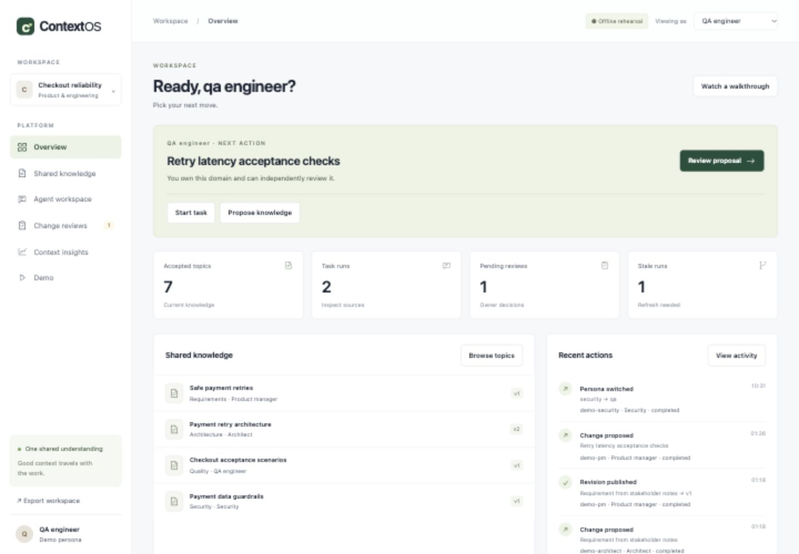

# ContextOS

**Define once. Share intelligently. Evolve together.**

ContextOS is a shared, governed memory workspace for software teams and their AI agents. Keep accepted requirements, architecture decisions, and constraints connected as work moves between Product, Architecture, Development, QA, and Security.

> **Status:** Working local hackathon prototype. Offline rehearsal is the default. Live Gemini, Firebase, Firestore, and Google Cloud deployment require separate verification. This repository does not claim production readiness or measured productivity savings.



## Why ContextOS?

A requirement should survive the handoff from a product conversation to implementation and testing. ContextOS gives every role a shared source of accepted knowledge, records exactly which revisions an agent used, and flags affected work when a decision changes.

- **Governed knowledge:** Propose → independent owner review → immutable accepted revision.
- **Bounded retrieval:** Permission filtering, mandatory constraints, explicit context budgets, and exact source manifests.
- **Change awareness:** Dependency-based stale-run alerts, fresh reruns, and rollback through new revisions.
- **Inspectable behavior:** Review comparisons, history, attributable audit events, and separate estimates/provider usage.
- **Interactive demo:** Five personas and twelve step-by-step walkthroughs with Next/Back, captured checkpoints, and a step activity log.

## Quick start

Prerequisites: **Python 3.14**, Git, and a browser. Node.js is needed only for the JavaScript syntax check; the UI has no frontend install or build step. No cloud account or API key is required for local rehearsal.

### macOS / Linux

```sh
python3 -m venv .venv
.venv/bin/python -m pip install -r requirements.txt
.venv/bin/uvicorn backend.app:app --host 127.0.0.1 --port 8000
```

### Windows PowerShell

```powershell
py -3.14 -m venv .venv
.\.venv\Scripts\python.exe -m pip install -r requirements.txt
.\.venv\Scripts\python.exe -m uvicorn backend.app:app --host 127.0.0.1 --port 8000
```

Open **[the workspace](http://127.0.0.1:8000)** or **[the Demo tab](http://127.0.0.1:8000/#demo)**.

Each browser gets an isolated synthetic checkout project. SQLite data persists in ignored `.data/contextos.db`. Use a private browser window for a fresh sandbox; existing workspaces are preserved. Persona switching is a demo facility, not real-user authentication.

Offline answers are explicitly labeled deterministic source briefings. To configure a live model later, see [.env.example](.env.example) and [DEPLOYMENT.md](DEPLOYMENT.md). Environment variables are set explicitly; `.env` is not loaded automatically.

## Try the complete workflow

1. Open **Overview** and use your persona’s **Next action** card, or open **Demo → Start walkthrough**. Advance one step at a time with **Next step**, revisit with **Back**, then finish. **Verify all 12 cases** runs the checks in bulk.
2. Choose **Try in workspace** to explore the corresponding persistent workflow.
3. As **Developer**, run a payment-retry task and inspect its source manifest.
4. Propose an architecture revision; switch to **Architect** to review and publish it.
5. Inspect the previous task's stale warning, then rerun with the updated source.

The Demo tab also covers note ingestion, manual authoring, restricted access, stale competing proposals, rejection, rollback, mandatory budget constraints, audit history, and truthful usage reporting. [Demo guide →](demo.md)

## Persona actions and next steps

Overview leads with a permission-scoped next action. Pending proposals owned by your persona come first, followed by your stale runs and a relevant task. CTAs open a review or prepare a task; publication still requires an explicit independent owner decision.

| Persona | Work to do | Review authority |
|---|---|---|
| Product manager | Define acceptance criteria; propose product decisions | Requirements |
| Architect | Assess design tradeoffs; propose architecture | Architecture |
| Developer | Prepare implementation work from accepted contracts | Implementation |
| QA engineer | Plan tests; refresh work after source changes | Quality |
| Security | Inspect guardrails and restricted findings | Security |

**Context insights → Persona activity** records actor, persona, action, timestamp, and outcome. Proposals, publication, rejection, tasks, context assembly, topic/manifest inspections, extraction, exports, and demo persona switches are logged. Domain-level blocked attempts and model-processing failures are recorded too. Restricted sources and derived activity remain permission-filtered.

The activity view/export returns the latest 100 visible events. It is a prototype workspace ledger, not a tamper-proof compliance archive. Unauthenticated requests, schema-validation errors, and ordinary navigation are outside its scope; at workspace capacity an additional failure log may be unavailable. Demo walkthroughs keep their own captured step activity and do not write to the persistent workspace.

The UI uses the institutional palette and typography from commit `4e1bd51`, alongside the newer CTA-focused layout and guided walkthroughs. Fonts load from Google Fonts, with system fallbacks when offline. Design references remain in `design_revamp/`.

## Development checks

From the repository root:

```sh
.venv/bin/pytest -q
node --check web/app.js
node --check web/auth.js
node --test tests/browser_auth.test.cjs
.venv/bin/python scripts/rehearsal.py
.venv/bin/python scripts/check_repo.py
```

Windows: use `.\.venv\Scripts\python.exe -m pytest -q` and the same Python executable for the helper scripts.

**56 Python tests and 4 browser-auth contract tests passed locally**, plus browser walkthroughs at mobile and desktop widths. Google service calls are mocked in adapter tests. [Verification details and limits →](TESTING.md)

GitHub Actions is configured to run tests, repository checks, JavaScript syntax validation, and a Linux container build after the repository is pushed. The latest hosted workflow outcome is **not verified in this session**; its configuration alone is not evidence of a successful Linux/cloud deployment.

## Architecture

```text
Buildless web UI
       │ same-origin JSON API
       ▼
FastAPI ── identity + policy ── governed revisions + retrieval
       │                              │
       ├─ Google Gen AI SDK           ├─ SQLite (local)
       │  Vertex / Gemini adapters    └─ Firestore adapter (cloud gate)
       └─ isolated synthetic demo scenarios
```

One deployable service keeps the prototype easy to run. A workspace is a bounded transactional aggregate: 30 contexts, 750 KB serialized storage, and 50 model-call attempts. Larger deployments need storage decomposition and operational controls. [Architecture and decisions →](design/architecture.md)

## Repository map

| Path | Purpose |
|---|---|
| `backend/` | API, authorization, governance, retrieval, persistence, model adapters, demo scenarios |
| `web/` | Buildless HTML/CSS/JavaScript workspace |
| `tests/` | Domain, API, concurrency, adapter and demo regression tests |
| `scripts/` | Non-destructive rehearsal, sandbox smoke check and repository hygiene |
| `.github/` | CI, dependency-update configuration, issue and PR templates |
| `artifacts/` | Synthetic demo screenshots |
| [features.md](features.md) / [requirements.md](requirements.md) | Feature status and acceptance requirements |
| [context.md](context.md) / [handoff.md](handoff.md) | Change rationale and resumable project context |
| [hackathon.md](hackathon.md) | Judging alignment and submission gates |
| [gemini.md](gemini.md) / [chatgpt.md](chatgpt.md) | Peer review and builder responses |

Original sources: [project blueprint](ContextOS_Complete_Project_Blueprint.md) and [event notes](ai_builder_cup_challenges_and_themes.txt).

## Person 3 delivery workstream

[Delivery scope and acceptance criteria](PERSON3_DELIVERY.md) now track real login/logout, verified sessions, managed database integration, remaining screens, task chat, hosting, CI/CD and monitoring. See [ordered plan](tasks/plan.md) and [task backlog](tasks/todo.md). Firebase/Firestore and Supabase/Postgres are compared; the owner selected Firebase Auth + Firestore + Cloud Run. These proposed capabilities are not yet completion claims.

## Limitations and next steps

The local demo is ready for review. Firebase-mode login/logout and protected browser sessions are implemented with mocked provider tests; real project verification remains open. Cloud setup remains deferred by the project owner. The GitHub target is [silent-doom/contextos](https://github.com/silent-doom/contextos). Live AI, durable cloud deployment, live Firebase sign-in verification, public judge access, and submission artifacts remain open gates. Semantic search, MCP/IDE integration, repository synchronization, and enterprise administration are future work. [Deployment guide →](DEPLOYMENT.md)

## Contributing and security

Read [CONTRIBUTING.md](CONTRIBUTING.md) before making changes. Keep synthetic demo data separate from real project information and follow [SECURITY.md](SECURITY.md) for vulnerability reporting. See [GITHUB_READY.md](GITHUB_READY.md) for repository settings to enable after publication.

## License

A distribution license has **not yet been selected**. No open-source license grant is implied. The project owner should choose and add an appropriate `LICENSE` before public release.
