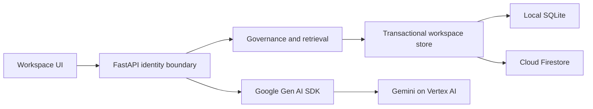

# Architecture

## Decision ADR-001: one deployable service

FastAPI serves a buildless HTML/CSS/JavaScript client and JSON API. Domain logic stays separate from transport, storage and model integration. This intentionally simplifies the blueprint's proposed Next.js/FastAPI pair for the short hackathon window. The UI needs no Node build toolchain.

## Decision ADR-002: bounded transactional workspace aggregate

A workspace contains contexts, immutable revision bodies, proposals, tasks and audit events. Local SQLite serializes mutations with BEGIN IMMEDIATE; Firestore uses a transaction on a per-workspace document. A strict serialized-size cap prevents exceeding Firestore's document limit. This is deliberately a bounded hackathon store; it is not an enterprise scaling claim. Migration to separate context/revision/run collections and object storage is required for larger projects. Never silently prune audit or revision history to fit the cap.

## Decision ADR-003: identity and authority

Demo mode issues an opaque HttpOnly SameSite cookie and isolates each browser's synthetic project. Persona changes are explicit demo impersonation. Firebase mode verifies bearer tokens and consumes administrator-set contextos_workspace and contextos_role claims. Browser-provided roles are never authoritative in Firebase mode. Default demo is unsuitable for confidential data. Cloud uses secure cookies.

Domain ownership: PM owns requirements, Architect architecture, QA quality, Developer implementation, Security security. All visible-context changes are proposals; only the designated domain owner can approve, and not their own proposal. Restricted context is visible only to Security. Every derived view rechecks all its source visibility. Approval and publication are one atomic operation; immutable proposals cannot be edited after approval.

## Retrieval and model boundary

Accepted authorized documents only. Include mandatory constraints, expand explicit dependency links, rank remaining candidates lexically, then fit whole documents into a disclosed conservative byte-based estimate. A mandatory overflow returns a clear error. Record exact payload sources before invocation. Gemini cannot publish, set roles, or modify policy. Source text is untrusted data. No model tool has write authority. Provider errors fail visibly rather than silently falling back.

## Change awareness

Publication walks explicit reverse dependency links, marks affected runs stale, and appends an audit event in the same transaction. Rerun creates a new snapshot. A source changed during inference also makes the completed run stale. Historical source bodies remain attached to the original manifest.

## Limits

Single bounded workspace aggregate; lexical retrieval; conservative estimates are not actual model token counts. Production Firebase sign-in UI, multi-project administration, queues, semantic search, custom policies and Cloud Storage revision objects are follow-up work.

## Decision ADR-004: isolated executable demo cases

The Demo tab reads a scenario catalog from `/api/demo/scenarios` and executes `/api/demo/scenarios/{id}` only in demo authentication mode. Each request creates a fresh in-memory synthetic domain state and uses the same authorization, proposal, review, retrieval and snapshot functions as the normal workspace. Rehearsal output explicitly uses the offline AI adapter even if the application has a live model configured. Results are transient UI-session evidence; they are not added to the workspace's task/audit/usage records.

This proves domain behavior without changing user data. The conflict scenario models two proposals against the same revision, while actual concurrent storage publication is separately tested by the regression suite. These demonstrations do not validate Firestore, live Gemini, or real Firebase sign-in. Hands-on links deliberately change the demo persona and open the relevant normal workspace view.

## Persona guidance and action ledger

`domain.next_actions` derives structured suggestions from the same role-filtered snapshot: independent domain-owner reviews, the persona's stale tasks, a role task goal and proposal authoring. UI dispatches only known action kinds. These are deterministic suggestions; no model chooses permissions or publishes changes.

Audit records optional role, outcome, source_ids and private_role, compatible with older events. Snapshot applies both direct context visibility and source dependency visibility to events. Task/inspection events reference all manifest sources. Domain failures are persisted in a separate transaction after the rejected mutation rolls back, without hidden target IDs or submitted content. A full workspace may prevent that append; original error responses are preserved. Prototype logging is not a tamper-proof compliance store.

Theme restoration: visual rules come from 4e1bd51; new action components use its existing semantic tokens. Font CSS and binaries are allowed only from fonts.googleapis.com and fonts.gstatic.com; system fallbacks keep UI usable offline. No JavaScript/business behavior was reverted.

## Selected Firebase identity and storage (18 October)

Owner chose Firebase Auth + Firestore + Cloud Run. Identity contract is design/specs/identity.md; Firebase-mode browser sessions use HttpOnly eight-hour cookies and CSRF-bound exchange, with trusted workspace/role claims and per-request revocation checks. Browser credentials go to Firebase REST and no ID/refresh tokens are persisted. The existing Bearer interface remains for API consumers.

Store initialization now distinguishes real empty workspaces from synthetic demo baselines, without modifying existing records. Firestore client rules deny direct browser access; server-side access uses IAM plus domain checks. The bounded JSON aggregate and atomic transaction boundary are retained. Supabase is not the selected provider; migration/normalization and live multi-instance/restore evidence remain separate work.
