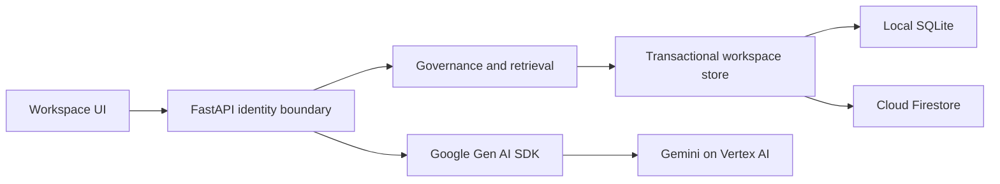

# Architecture

## Decision ADR-001: one deployable service

FastAPI serves a buildless HTML/CSS/JavaScript client and JSON API. Domain logic stays separate from transport, storage and model integration. This intentionally simplifies the blueprint's proposed Next.js/FastAPI pair for the short hackathon window. The UI needs no Node build toolchain.

## Decision ADR-002: bounded transactional workspace aggregate

A workspace contains contexts, immutable revision bodies, proposals, tasks and audit events. Local SQLite serializes mutations with BEGIN IMMEDIATE; Firestore uses a transaction on a per-workspace document. A strict serialized-size cap prevents exceeding Firestore's document limit. This is deliberately a bounded hackathon store; it is not an enterprise scaling claim. Migration to separate context/revision/run collections and object storage is required for larger projects. Never silently prune audit or revision history to fit the cap.

## Decision ADR-003: identity and authority

Demo mode issues an opaque HttpOnly SameSite cookie and isolates each browser's synthetic project. Persona changes are explicit demo impersonation. Firebase mode verifies bearer tokens and consumes administrator-set contextos_workspace and contextos_role claims. Browser-provided roles are never authoritative in Firebase mode. Default demo is unsuitable for confidential data. Cloud uses secure cookies.

Domain ownership: PM owns requirements, Architect architecture, QA quality, Developer implementation, Security security. All visible-context changes are proposals; only the designated domain owner can approve, and not their own proposal. Restricted context is visible only to Security. Every derived view rechecks all its source visibility. Approval and publication are one atomic operation; immutable proposals cannot be edited after approval.

## Retrieval and model boundary

Accepted authorized documents only. Include mandatory constraints, expand explicit dependency links, rank remaining candidates lexically, then fit whole documents into a disclosed conservative byte-based estimate. A mandatory overflow returns a clear error. Record exact payload sources before invocation. Gemini cannot publish, set roles, or modify policy. Source text is untrusted data. No model tool has write authority. Provider errors fail visibly rather than silently falling back.

## Change awareness

Publication walks explicit reverse dependency links, marks affected runs stale, and appends an audit event in the same transaction. Rerun creates a new snapshot. A source changed during inference also makes the completed run stale. Historical source bodies remain attached to the original manifest.

## Limits

Single bounded workspace aggregate; lexical retrieval; conservative estimates are not actual model token counts. Production Firebase sign-in UI, multi-project administration, queues, semantic search, custom policies and Cloud Storage revision objects are follow-up work.
